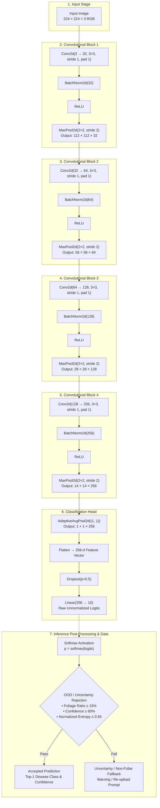
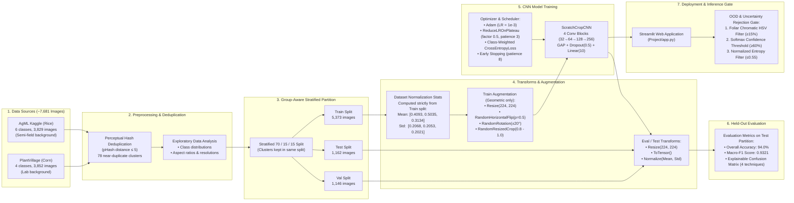

# System Architecture & Pipeline Workflow Diagrams

This directory contains the structural and procedural diagrams for the **Crop Disease Detection Using CNN** system.

---

## 1. Convolutional Neural Network Architecture (`ScratchCropCNN`)

---

## 2. End-to-End Pipeline Workflow

